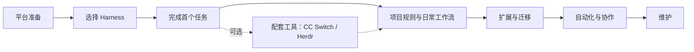

# AI Agents

从环境准备到真实项目工作流，逐步学习 Codex、Claude Code、OpenCode、Pi、oh-my-pi、DSH、Kimi Code、WorkBuddy 与 Hermes。Windows 以 Git Bash 为主并介绍 PowerShell 7，兼顾 WSL、macOS 与 Linux。

## 这套教程能帮助你做什么

你将准备环境、安装并登录一款 Harness、完成可检查的文件任务，再学习项目规则、扩展、自动化与多 Agent 协作。各工具能力以官方资料为准，示例会注明核验范围。

## 选择你的学习路线

- Windows 原生：先看[Git Bash 与 PowerShell 7](getting-started/windows.md)。
- WSL：先看[WSL 环境准备](getting-started/wsl.md)，理解与 Windows 原生的边界。
- macOS / Linux：[平台环境准备](getting-started/macos-linux.md)。
- Python 项目或 MCP 服务需要 Python 时，再看[uv 与 Anaconda3](getting-started/python-environments.md)。

## 选择一款 Harness

- [Codex CLI](harnesses/codex.md)
- [Claude Code CLI](harnesses/claude-code.md)
- [OpenCode](harnesses/opencode.md)
- [Pi](harnesses/pi.md)
- [oh-my-pi](harnesses/oh-my-pi.md)
- [DSH（DeepSeek Harness）](harnesses/dsh.md)
- [Kimi Code CLI](harnesses/kimi-code.md)
- [WorkBuddy](harnesses/workbuddy.md)
- [Hermes Agent](harnesses/hermes.md)

不确定怎么选？先完成[概念入门](getting-started/concepts.md)，再看[工具选择与迁移](workflows/selection-and-migration.md)。

## 按需配置配套工具

选定并用过一款 Harness 后，再按需要使用下面两款工具：

- [CC Switch：配置切换](tools/cc-switch.md)。需要管理多个提供商或受支持客户端时阅读，先确认客户端自己的认证方式与配置位置。
- [模型 API 协议与接入](tools/api-protocols.md)。分清 Chat Completions、Responses 和 Anthropic Messages，以 DeepSeek 为例配置 Codex、Claude Code，理解何时需要协议转换。
- [Herdr：终端组织](tools/herdr.md)。需要标签页、分屏和会话管理时阅读；基础布局无需多 Agent，协作部分可在掌握后面的自动化原则后回来实践。

按需选择这些专题，不影响直接继续学习日常工作流。

## 从基础任务到配置与扩展

1. [认识 Agent 与 Harness](getting-started/concepts.md)
2. [完成第一个 Agent 任务](getting-started/first-task.md)
3. [建立日常开发工作流](workflows/daily-development.md)
4. [撰写 AGENTS.md 与管理上下文](workflows/project-instructions.md)
5. [扩展：Skills、MCP 与插件](workflows/extensions.md)

## 迁移、自动化与协作

需要更换工具时阅读[工具选择与迁移](workflows/selection-and-migration.md)。准备脚本化任务或并行处理工作时，先阅读[自动化与多 Agent 协作](workflows/automation.md)中的分工与隔离原则，再按需返回 [Herdr 的协作部分](tools/herdr.md#multi-agent-workflow)实践。

## 遇到问题与版本变化

查阅[常见问题](reference/troubleshooting.md)、[术语与命令速查](reference/glossary-and-cheatsheet.md)及[版本核验与教程维护](reference/maintenance.md)。

## 学习路线图

页面提供的是文档教程，不代表作者已在所有平台实测。安装、认证、服务商费用和功能状态请以链接的官方资料为准。
