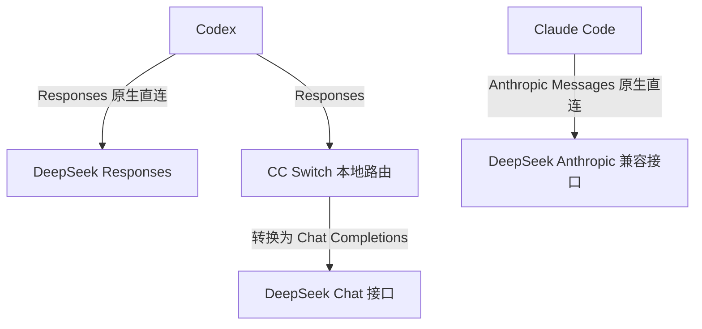
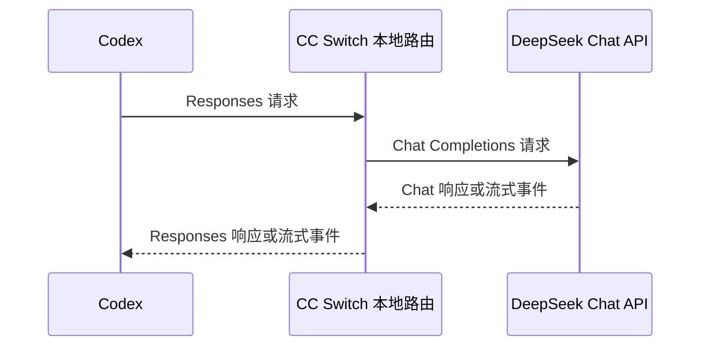

# 模型 API 协议与接入

同一个 DeepSeek 模型可以通过不同的 API 格式接入不同的 Harness。本页先解释三类常见接口，再通过 CC Switch 配置 Codex 和 Claude Code，最后演示需要转换协议时的本地路由。

先完成一款 [Harness](../index.md) 的安装，并读完 [CC Switch 安装与配置](cc-switch.md)。核验日期：2026-10-22；资料依据见文末。本页没有使用真实凭据，也没有执行模型请求；截图来自 CC Switch 官方教程。

!!! tip "先选择你的路线"
    - **Codex + DeepSeek**：优先使用 DeepSeek 原生 Responses 接口。
    - **Claude Code + DeepSeek**：使用 DeepSeek 的 Anthropic Messages 兼容接口。
    - **Codex + 只提供 Chat Completions 的端点**：由 CC Switch 本地路由转换协议。本页用 DeepSeek 的 Chat 接口演示这条可选路线。

## 先分清模型、提供商、协议和工具

| 概念 | 本页示例 | 配置时对应什么 |
| --- | --- | --- |
| 模型 | `deepseek-v4-pro` | `model` 或模型映射，决定实际调用哪个模型 |
| 提供商 | DeepSeek 官方开放平台 | API Key、服务地址、可用模型和账户额度 |
| API 格式 | Chat Completions、Responses、Anthropic Messages | 请求路径、JSON 字段、工具调用格式及流式事件 |
| Harness | Codex、Claude Code | 负责读取项目、调用模型和执行本地工具 |
| 配置管理与转接 | CC Switch | 保存并切换客户端配置，必要时通过本地路由转换请求与响应 |

这里的“协议”指应用层 API 契约。三类接口都可以通过 HTTPS 传输，但它们的请求和返回内容不同。把 Base URL 改成另一个域名，不会自动把一种 JSON 格式变成另一种。

“兼容 OpenAI”也需要进一步问：**兼容 Chat Completions，还是 Responses？** 提供了 `/chat/completions`，并不能证明同时提供 `/responses`。同样，通过 Anthropic 格式调用 DeepSeek，实际运行的仍然是 DeepSeek 模型。

模型 API 与 [MCP](../workflows/extensions.md) 也处在不同位置：前者连接模型服务，后者为 Agent 接入外部工具与资源。选择 MCP 服务器不能替代模型 API 配置。

## 三种 API 格式有什么区别

### 接口、请求体和返回结构

下表的路径是各类 API 的常见形式；使用兼容服务时，还需核对该提供商的 Base URL 和支持范围。

| API 格式 | 常见请求路径 | 典型输入 | 典型输出 |
| --- | --- | --- | --- |
| OpenAI Chat Completions | `POST /v1/chat/completions` | `messages` 消息数组 | `choices` 中的消息、`tool_calls` |
| OpenAI Responses | `POST /v1/responses` | `input`，可另设 `instructions` | `output` 中的消息、函数调用等项目 |
| Anthropic Messages | `POST /v1/messages` | `messages`、独立的 `system`、`max_tokens` | `content` 中的文本块或 `tool_use` |

下面用同一个模型和相同问题比较请求体。它们只是 JSON 示意，不是终端命令，也不包含认证信息。Responses 的完整 `input` 可以是项目数组，Anthropic 的 `content` 也可以是内容块数组，不能仅按下面最简单的文本情况实现转接。

=== "Chat Completions"
    ```json
    {
      "model": "deepseek-v4-pro",
      "messages": [
        {"role": "system", "content": "请用中文回答。"},
        {"role": "user", "content": "解释这个项目的目录结构。"}
      ]
    }
    ```

=== "Responses"
    ```json
    {
      "model": "deepseek-v4-pro",
      "instructions": "请用中文回答。",
      "input": "解释这个项目的目录结构。",
      "store": false
    }
    ```

=== "Anthropic Messages"
    ```json
    {
      "model": "deepseek-v4-pro",
      "system": "请用中文回答。",
      "max_tokens": 1024,
      "messages": [
        {"role": "user", "content": "解释这个项目的目录结构。"}
      ]
    }
    ```

认证也有区别。OpenAI 风格服务通常使用 `Authorization: Bearer …`；Anthropic 官方 API 常用 `x-api-key` 和 `anthropic-version`。Claude Code 接入 DeepSeek 的官方示例使用 `ANTHROPIC_AUTH_TOKEN`。优先让客户端及经过核实的预设生成请求头，不要只替换 URL 后照搬另一服务的认证配置。

### 为什么“可以聊天”还不够

编码 Agent 不断执行“模型要求调用工具 → 本地执行 → 把结果交回模型”的循环。Chat Completions 的 `tool_calls`、Responses 的函数调用项目、Anthropic 的 `tool_use/tool_result`，需要保持调用 ID、参数和执行结果之间的对应关系。

流式输出也不是把文本逐段转发就结束：不同 API 使用不同的事件名称和结束标记。思考内容、图片输入、并行工具调用和上下文续接还可能有额外限制。因此，普通问答成功只是第一步，还要验证实际的文件读取和后续工具调用。

### Codex 的“chat”与“responses”该怎么理解

旧教程或某些配置界面可能出现 `wire_api = "chat"`。截至核验日期，OpenAI 的 [Codex 配置参考](https://developers.openai.com/codex/config-reference/)明确：`wire_api` 只支持 `"responses"`。

如果 CC Switch 的**上游格式**选了 Chat Completions，意思是“本地路由向提供商发送 Chat 请求”；Codex 到本地路由这一段仍然使用 Responses。不要据此把当前 Codex 的 `wire_api` 改成 `chat`。

## DeepSeek API 的三个入口

DeepSeek 当前同时提供 Chat Completions、Responses 和 Anthropic 兼容接口。下面采用官方服务，示例模型统一为 `deepseek-v4-pro`；实际模型可用性以账户和[当前官方文档](https://api-docs.deepseek.com/zh-cn/)为准。

| 用途 | 在客户端或 CC Switch 中填写的地址 | 请求最终到达的接口 |
| --- | --- | --- |
| Chat Completions | `https://api.deepseek.com/v1` | `/v1/chat/completions` |
| Codex 原生 Responses | `https://api.deepseek.com` | `/responses` |
| Claude Code 的 Anthropic 接口 | `https://api.deepseek.com/anthropic` | `/anthropic/v1/messages` |

DeepSeek 官方示例也使用 `/v1/responses`。本页 Codex 的 Base URL 按其[官方 Codex 集成指南](https://api-docs.deepseek.com/quick_start/agent_integrations/codex/)使用根地址；兼容前缀不代表模型版本。

!!! note "Base URL 与完整请求 URL"
    CC Switch 的普通请求地址字段填写基础地址，由客户端或路由追加接口路径。不要把 `/chat/completions`、`/responses` 或 `/messages` 再填进去，导致路径重复。只有明确使用界面中的“完整 URL”功能时，才按该功能说明填写完整路径。

本页使用 DeepSeek 开放平台创建的 API Key。第三方平台托管的同名模型有自己的地址、密钥和额度；DeepSeek 网页聊天登录也不能直接当作 API Key 填入客户端。

## CC Switch：配置切换和协议转换

两种工作方式可以放在一张图里理解：



**直连时**，CC Switch 把提供商配置写给客户端，模型请求直接发往 DeepSeek。完成配置后，不需要为了协议转换而让本地路由常驻。

**转换时**，客户端先把请求发往 CC Switch 的本地地址，路由完成格式转换后再访问 DeepSeek，同时转换返回内容。本地路由必须保持运行；切换供应商卡片本身不会启动一个可用的转换链路。

当前 CC Switch 的[添加提供商说明](https://github.com/farion1231/cc-switch-website/blob/main/public/docs/zh/2-providers/2.1-add.md)将新版 DeepSeek Codex 预设列为**原生 Responses**。旧供应商卡片保存的是创建时的配置快照；升级软件后，旧卡片可能仍然保留 Chat 路由设置。

## 配置前准备

1. 按 [CC Switch 教程](cc-switch.md)安装软件，并确认 Codex 或 Claude Code 已能正常启动。
2. 从 [DeepSeek 开放平台](https://platform.deepseek.com/)创建 API Key，确认账户有对应模型的使用权限。
3. 备份将被修改的客户端配置。保留能恢复的官方提供商卡片；截图和分享日志时隐藏密钥。
4. 确认 CC Switch 管理的是 CLI 实际使用的那一侧配置：Windows 原生与 WSL 的 HOME 和配置目录不同。
5. 首次只配置一个客户端和一种协议，完成验证后再加第二条路线。

软件版本可以在普通终端查看：

```bash
codex --version
claude --version
```

只安装其中一款的读者运行相应一条即可。配置过程在 CC Switch 界面完成；下面的 `<DEEPSEEK_API_KEY>` 都是需要由读者替换的占位符。

## 路线一：Codex 使用 DeepSeek 原生 Responses { #codex-responses }

这条路线优先使用当前预设，不需要先搭协议转换服务。

1. 在 CC Switch 中选择 **Codex**，进入**直连**视图，点击**添加供应商**。
2. 搜索并选择 **DeepSeek** 官方预设。已有旧卡片时建议新建一张，先保留旧卡便于恢复。
3. 填入 DeepSeek API Key，并检查以下字段。

    | 字段 | 本例取值或要求 |
    | --- | --- |
    | 名称 | `DeepSeek — Responses`，名称可自定 |
    | 请求地址 | `https://api.deepseek.com` |
    | 上游格式 | `Responses`，即原生 Responses |
    | 模型 | `deepseek-v4-pro`；也可选择当前预设列出的其他可用模型 |
    | Codex 配置中的 `wire_api` | `responses` |
    | 模型目录/映射 | 保留当前预设生成的目录，并确认包含所选模型 |

4. 保存并启用该供应商，退出旧 Codex 会话后重新启动。
5. 在 Codex 中确认选中的模型和提供商，再执行后面的最小验证任务。

Codex 使用非默认模型时还需要正确的模型目录、能力声明及对应 Harness。DeepSeek 官方[集成说明](https://api-docs.deepseek.com/quick_start/agent_integrations/codex/)给出了最低 Codex 版本和目录配置；当前 CC Switch 预设会处理相应模型目录。若模型未出现在选择列表，先检查客户端版本和预设目录，不要仅把默认模型的名字改成 DeepSeek。

认证字段由 CC Switch 按版本写入客户端配置；不要把网上的另一份 `auth.json` 或 `config.toml` 整份覆盖进去。这里要核对的是**实际提供商、Base URL、Responses 格式和模型目录**。

!!! tip "旧卡片仍显示“需要路由”"
    先看它保存的上游格式。需要迁移到原生 Responses 时，新建当前 DeepSeek 预设，核对地址和模型后再启用。保留旧卡片并不妨碍迁移；不要通过关闭全部路由服务来判断某一张卡片是否已改成直连。

## 路线二：Claude Code 使用 Anthropic 兼容接口 { #claude-anthropic }

DeepSeek 官方为 Claude Code 提供专门的 Anthropic 兼容入口。客户端仍然使用 Anthropic 消息格式，服务端运行 DeepSeek 模型。

1. 在 CC Switch 中选择 **Claude Code**，添加 **DeepSeek** 官方预设。
2. 填入 API Key，确认请求地址是 `https://api.deepseek.com/anthropic`。
3. 查看预设的模型映射。本例把常用角色都映射到 `deepseek-v4-pro`，便于观察同一模型在不同客户端中的接入方式。
4. 保存并启用，重新启动 Claude Code。
5. 查看当前模型配置，执行最小验证任务；以后可按自己的需求分别调整角色映射。

下面是相关字段的示意，用来对照 CC Switch 的配置预览；请合并到现有配置，不要整份替换文件：

```json title="Claude Code 配置中的相关字段"
{
  "env": {
    "ANTHROPIC_BASE_URL": "https://api.deepseek.com/anthropic",
    "ANTHROPIC_AUTH_TOKEN": "<DEEPSEEK_API_KEY>",
    "ANTHROPIC_DEFAULT_HAIKU_MODEL": "deepseek-v4-pro",
    "ANTHROPIC_DEFAULT_SONNET_MODEL": "deepseek-v4-pro",
    "ANTHROPIC_DEFAULT_OPUS_MODEL": "deepseek-v4-pro"
  }
}
```

这里的 Haiku、Sonnet、Opus 是 Claude Code 使用的模型角色，映射后对应的实际模型是 DeepSeek。保留 [Windows Git Bash 路径设置](../harnesses/claude-code.md)等已有配置；若终端环境变量、项目设置或其他管理器又指定了不同地址，需要先查清最终生效的配置来源。

来源：[DeepSeek 的 Claude Code 集成](https://api-docs.deepseek.com/zh-cn/quick_start/agent_integrations/claude_code)、[Anthropic 兼容说明](https://api-docs.deepseek.com/zh-cn/guides/anthropic_api)。

## 路线三：Codex 经本地路由使用 Chat 接口 { #codex-chat-routing }

这条路线用于理解协议转换，或接入只有 Chat Completions 的其他端点。**当前 DeepSeek 已有原生 Responses，日常使用优先选择路线一。**

### 配置上游格式和模型映射

1. 在 CC Switch 的 Codex 页面新建一张独立的供应商卡片，名称可设为 `DeepSeek — Chat 路由练习`。
2. 使用自定义配置，或复制 DeepSeek 卡片后编辑。选择 **Chat Completions** 上游格式，而不是 Responses。
3. 将请求地址设为 `https://api.deepseek.com/v1`，填入 API Key，并配置上游模型 `deepseek-v4-pro`。
4. 核对模型目录中对外可选模型与实际上游模型的对应关系，再保存卡片。当前界面通常会显示**需要路由**。

Codex 自身的 `wire_api` 仍然是 `responses`。API 格式选项保存在 CC Switch 的提供商设置中，由路由把它转换成 Chat 请求；不要为了通过本地模型检查而把上游模型 ID 填成一个 DeepSeek 不提供的 GPT 模型名。

{ loading=lazy width="900" }

*图 1：CC Switch 官方路由教程中的旧版表单示意。该图展示路由配置的位置；新版的“上游格式”等字段以实际界面为准。图片中的“需要本地路由映射”不代表现在所有 DeepSeek 配置都需要路由。*

### 启动路由并接管 Codex

1. 在 Codex 的**路由**视图或**设置 → 路由**中启动本地路由，并为 **Codex** 启用路由接管；入口名称以当前版本为准。
2. 选中刚才的 Chat 路由练习卡片，确认路由服务正在运行，且当前上游是该卡片。
3. 查看界面显示的本地地址。截图中的 `127.0.0.1:15721` 只是示例，以自己安装版本实际显示的地址和端口为准。
4. 重新启动 Codex，让它读取接管后的配置，再执行最小验证。

{ loading=lazy width="900" }

*图 2：确认总开关、Codex 接管和实际供应商。截图里的请求数及成功率是官方示例数据，不是本站的运行结果。*

此时完整的数据流是：



保持 CC Switch 的路由服务运行。这里不是普通网络代理：它会处理请求体、响应体和事件格式。Windows 的本地路由与 WSL 中的客户端能否互相访问，需要按当前网络和监听设置核验，不能直接假定两侧的 `127.0.0.1` 指向同一服务。

## 如何确认接入真正生效

先在独立练习项目中发送一个简单问题，例如“只用一句中文说明你已收到请求”。收到正常响应后，再做一次只读工具任务：

```text
请读取当前目录的 README.md，列出其中三个要点。
不要修改文件，不运行安装命令，也不要提交代码。
```

| 检查点 | 直连路线 | 本地路由路线 |
| --- | --- | --- |
| 客户端配置 | 指向相应 DeepSeek 官方入口 | 指向 CC Switch 当前本地接管地址 |
| 协议 | Codex 为 Responses，Claude Code 为 Anthropic Messages | Codex 到路由为 Responses，上游按卡片设为 Chat |
| 实际模型 | 核对所选模型与角色映射 | 还要核对路由的上游模型映射 |
| 工具调用 | 能读取文件，并基于工具结果继续回答 | 同时检查转换后的工具调用能否完整往返 |
| 请求证据 | 客户端诊断、DeepSeek 账户用量等 | 额外检查 CC Switch 路由记录 |

模型自称“我是某某模型”不能作为路由证据。界面的“测速成功”“模型测试成功”也不等于文件工具、多轮上下文和全部流式场景都已验证。

使用原生直连时，CC Switch 路由日志没有对应请求并不一定是故障；这条路线本来就不经过本地路由。

## 常见错误与恢复

| 现象 | 优先检查 |
| --- | --- |
| `404`、接口不存在 | Base URL 与路径是否重复；Chat、Responses、Anthropic 入口是否选错 |
| `401/403` | API Key 属于哪个平台；当前端点是否匹配；认证配置是否被另一来源覆盖 |
| 模型不存在 | 模型 ID、账户可用范围、Codex 模型目录与上游映射 |
| Codex 不接受 `wire_api = "chat"` | 恢复 `responses`，把 Chat 上游配置放到 CC Switch 路由中 |
| `400` 或工具调用失败 | 请求字段、工具格式、思考参数和流式事件的兼容范围 |
| 关闭 CC Switch 后连接失败 | 客户端是否仍指向本地路由；路由是否被停止 |
| 普通问答可用，读文件失败 | 检查工具调用转换与返回，而不只检查模型文本输出 |
| WSL 中与 Windows 表现不同 | 两侧配置文件、环境变量、客户端版本及本地服务可达性 |

恢复时，在 CC Switch 切回已保留的提供商，按界面流程退出当前客户端的路由接管，再检查其配置是否仍指向本地地址。重启客户端并重新验证。其他应用还在使用路由时，不要为恢复一个客户端而停止整个服务。

## 练习与下一步

- 能指出同一条链路中，**客户端协议**和**上游协议**分别是什么。
- 用原生 Responses 和 Anthropic 两条路线分别整理一份无密钥的配置记录，包括客户端、地址、模型及验证状态。
- 需要学习转换时再做 Chat 路由练习，记录与原生路线的区别，并能恢复之前的配置。
- 继续学习 [Skills、MCP 与扩展](../workflows/extensions.md)，为已配置好的 Agent 增加外部能力。

## 官方资料与配图来源

- [OpenAI：Chat Completions 与 Responses](https://developers.openai.com/api/docs/guides/migrate-to-responses/)
- [OpenAI：Codex 配置参考](https://developers.openai.com/codex/config-reference/)
- [Anthropic：Messages API](https://platform.claude.com/docs/en/api/messages/create)
- [DeepSeek：Responses API](https://api-docs.deepseek.com/zh-cn/guides/responses_api/)
- [DeepSeek：Codex 集成](https://api-docs.deepseek.com/quick_start/agent_integrations/codex/)
- [DeepSeek：Anthropic 兼容接口](https://api-docs.deepseek.com/zh-cn/guides/anthropic_api)
- [DeepSeek：Claude Code 集成](https://api-docs.deepseek.com/zh-cn/quick_start/agent_integrations/claude_code)
- [CC Switch：添加供应商](https://github.com/farion1231/cc-switch-website/blob/main/public/docs/zh/2-providers/2.1-add.md)
- [CC Switch：本地路由说明](https://github.com/farion1231/cc-switch-website/blob/main/public/docs/zh/4-proxy/4.1-service.md)
- [CC Switch：DeepSeek 路由教程与原图](https://github.com/farion1231/cc-switch-website/blob/main/public/docs/tutorials/zh/codex-deepseek-routing-guide.md)。两张截图均下载自该官方教程，仅作为界面示意。
